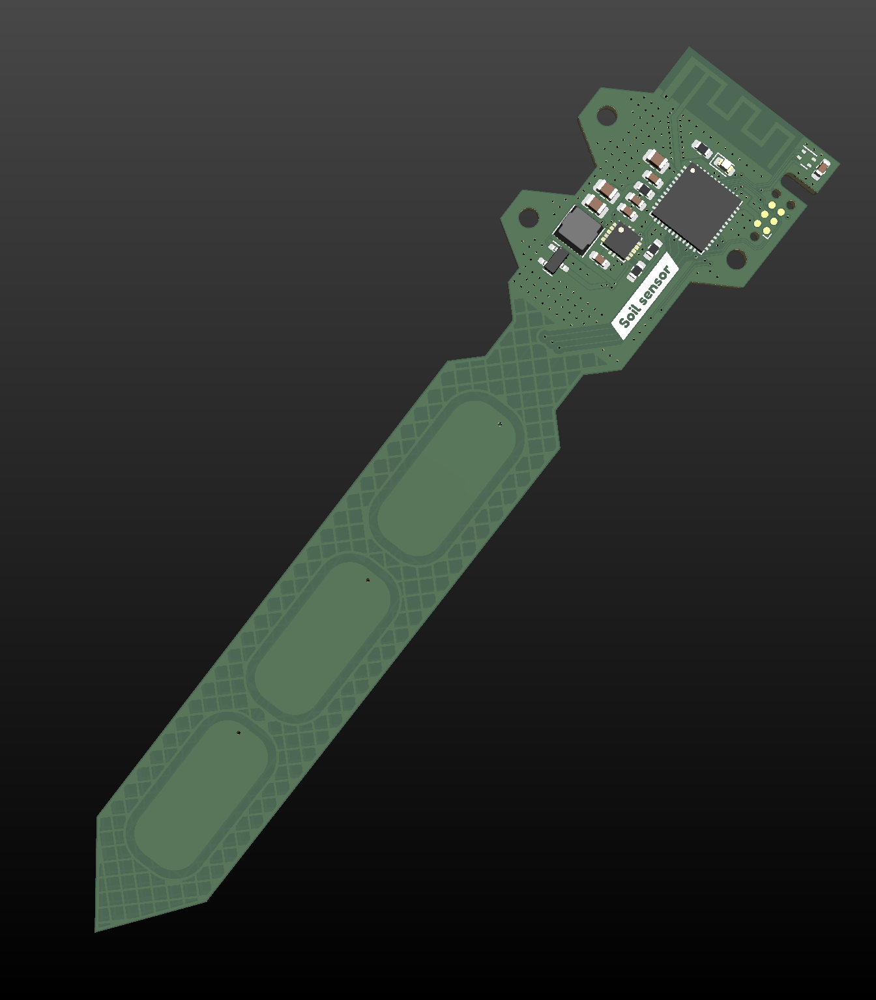

# soil-sensor 🌱
Schematic and PCB for a capacitive soil moisture sensor.



**See [latest release](../../releases/latest) for schematic and gerbers.**

## Firmware (nRF Connect SDK)

This repo is a [west workspace application](https://docs.nordicsemi.com/bundle/ncs-latest/page/nrf/dev_model_and_contributions/adding_code.html#workflow_4_workspace_application_repository_recommended):
[`west.yml`](west.yml) pins the nRF Connect SDK version and the u-blox EVK-NORA-B10 board support.

Install the matching toolchain (`nrfutil sdk-manager toolchain install --ncs-version v3.4.2`), then set up the workspace:

```sh
mkdir soil-sensor-ws && cd soil-sensor-ws
git clone <this repo> soil-sensor
west init -l soil-sensor
west update
```

Build and flash the sensor firmware:

```sh
cd soil-sensor
west build -b ubx_evknorab10/nrf5340/cpuapp devices/soil-sensor/firmware/v1
west flash
```

To bump the SDK, change the `nrf` revision in `west.yml` and run `west update`.
